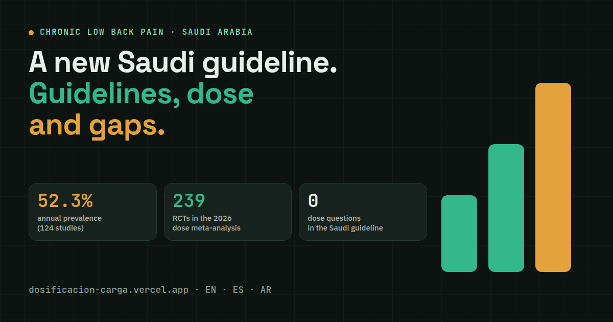

# Chronic low back pain in Saudi Arabia and load dosing

An online report on chronic low back pain in Saudi Arabia (2026 national guideline, international guidelines, exercise dose evidence and gaps) and a plan for a load dosing project in rehabilitation.

**Site:** https://dosificacion-carga.vercel.app



## Contents

- `index.html`: cover page with links to the three versions and to the plan.
- `lumbar-saudi-es.html`: chronic low back pain in Saudi Arabia, in Spanish.
- `lumbar-saudi-en.html`: the same page in English.
- `lumbar-saudi-ar.html`: the same page in Arabic (RTL; pending native review, and the page says so).
- `plan.html`: load dosing project plan: objective, three modules (Achilles tendinopathy, hamstrings, chronic low back pain), limits of the data, a roadmap of about 12 weeks, requirements for a study in Riyadh, risks and references.

The pages are self-contained HTML with inline CSS and JavaScript. Each section is a **tab** (the menu, the index and the previous/next buttons open it, and a URL with `#section` links directly to it); without JavaScript they display in full. They include **original anatomical drawings in SVG**: a lateral view of the lumbar spine with vertebrae, discs and four muscle groups (interactive), pictograms of the three McGill exercises and, in the plan, a body map of the three regions. They are illustrative diagrams, not to scale. They respect `prefers-reduced-motion`. They depend only on Google Fonts.

## Sources and verification

Each page lists its sources with a link. "Abstract only" indicates that the figure was taken from the abstract and not from the full text; "not verified" marks what still needs to be confirmed. The main figures were checked against the original sources on 25 and 26 October 2026: prevalence (Al Amer 2026), the Saudi guideline (Aldera 2026), the NICE NG59 update (July 2026), the dose meta-analysis (Arora 2026) and the TEAch trial sample size (ClinicalTrials.gov NCT04059146).

## How to rebuild

Requires Python 3, with no external dependencies. It works on Windows, macOS and Linux (UTF-8 reading and writing).

```bash
cd src
python3 build.py        # writes the five HTML files to the root
python3 render_og.py    # optional: regenerates og.png from og.html (requires Chrome or Edge)
```

- `src/common.py`: shared palette, CSS and JS.
- `src/template.html` with `src/es.py`, `src/en.py` and `src/ar.py`: text for each language of the low back pain page.
- `src/plan_template.html`: project plan (Spanish only).
- `src/index_template.html`: cover page.
- `src/anatomy.py` and `src/anatomy_text.py`: anatomical drawings and their text in ES, EN and AR.
- `src/og.html`: composition of the social image (`og.png`).

If any key is missing from a template, the script stops and names it.

## Deployment

Static site with no build step on Vercel: the root files are served as they are.

## Licence

Original text and figures under CC BY 4.0; code under MIT. Cited sources keep their own rights. See [LICENSE.md](LICENSE.md).

## Disclaimer

Educational information based on published sources. It is not medical advice and does not replace assessment by a health professional.
