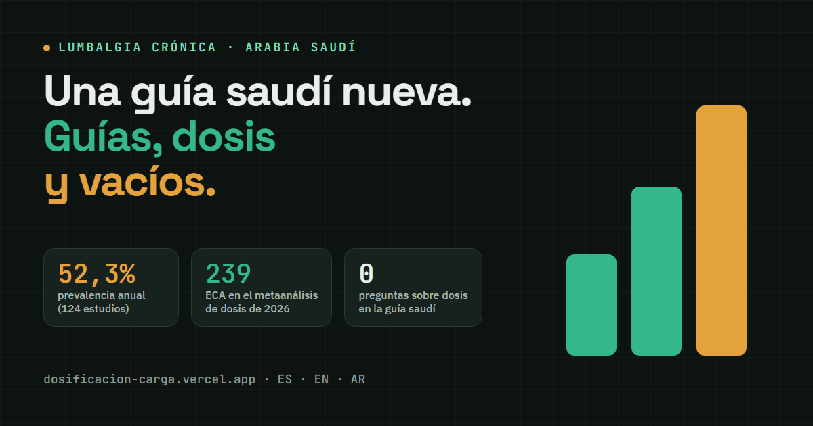

# Lumbalgia en Arabia Saudí y dosificación de carga

Informe en línea sobre dolor lumbar crónico en Arabia Saudí (guía nacional 2026, guías internacionales, evidencia de dosis de ejercicio y vacíos) y plan de un proyecto de dosificación de carga en rehabilitación.

**Sitio:** https://dosificacion-carga.vercel.app



## Contenido

- `index.html`: portada con enlaces a las tres versiones y al plan.
- `lumbar-saudi-es.html`: lumbalgia crónica en Arabia Saudí, en español.
- `lumbar-saudi-en.html`: la misma página en inglés.
- `lumbar-saudi-ar.html`: la misma página en árabe (RTL; pendiente de revisión nativa, la página lo indica).
- `plan.html`: plan del proyecto de dosificación de carga: objetivo, tres módulos (tendinopatía aquílea, isquiosurales, lumbalgia crónica), límites de los datos, hoja de ruta de unas 12 semanas, requisitos para un estudio en Riad, riesgos y referencias.

Las páginas son HTML autónomo con CSS y JavaScript en línea (animaciones al hacer scroll, barra de progreso, contadores). Respetan `prefers-reduced-motion`. Solo dependen de Google Fonts.

## Fuentes y verificación

Cada página lista sus fuentes con enlace. "Solo resumen" indica que el dato se tomó del resumen y no del texto completo; "sin verificar" marca lo que aún debe confirmarse. Las cifras principales se contrastaron con las fuentes originales el 25–26 de octubre de 2026: prevalencia (Al Amer 2026), guía saudí (Aldera 2026), actualización de NICE NG59 (julio de 2026), metaanálisis de dosis (Arora 2026) y tamaño del ensayo TEAch (ClinicalTrials.gov NCT04059146).

## Cómo reconstruir

Requiere Python 3, sin dependencias externas. Funciona en Windows, macOS y Linux (lectura y escritura en UTF-8).

```bash
cd src
python3 build.py        # escribe los cinco HTML en la raíz
python3 render_og.py    # opcional: regenera og.png desde og.html (requiere Chrome o Edge)
```

- `src/common.py`: paleta, CSS y JS compartidos.
- `src/template.html` con `src/es.py`, `src/en.py` y `src/ar.py`: textos de cada idioma de la página de lumbalgia.
- `src/plan_template.html`: plan del proyecto (solo español).
- `src/index_template.html`: portada.
- `src/og.html`: composición de la imagen para redes (`og.png`).

Si falta alguna clave en una plantilla, el script se detiene y la indica.

## Despliegue

Sitio estático sin paso de compilación en Vercel: se sirven los archivos de la raíz tal cual.

## Licencia

Textos y figuras propias bajo CC BY 4.0; código bajo MIT. Las fuentes citadas conservan sus propios derechos. Ver [LICENSE.md](LICENSE.md).

## Aviso

Información educativa basada en fuentes publicadas. No es consejo médico ni sustituye la valoración de un profesional sanitario.
